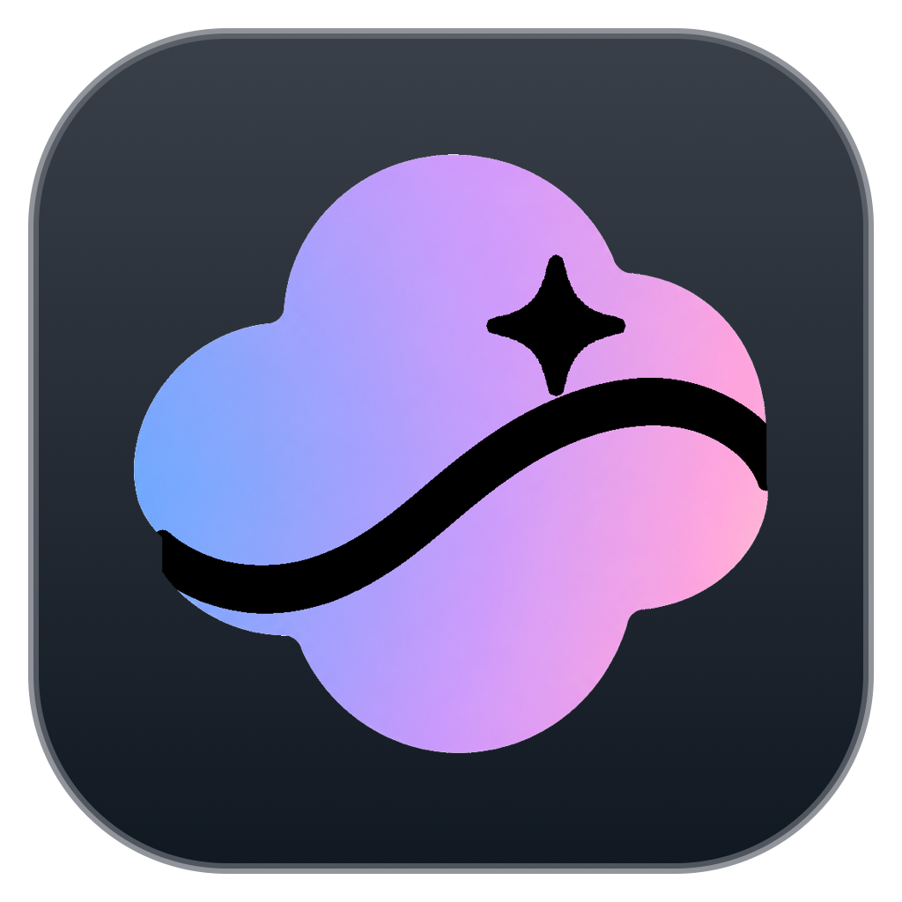

<p align="center">
  
</p>

<h1 align="center">Skill Atmosphere</h1>

<p align="center">
  A calm, local-first AI Skill workspace for macOS.<br />
  Turn installed Skills, research intent, prompt compilation, and saved knowledge into a personal capability space.
</p>

<p align="center">
  <strong>English</strong> · <a href="README.zh-CN.md">简体中文</a>
</p>


## Overview

Skill Atmosphere is not a conventional file manager and not a chatbot shell. It is a macOS-first workspace that turns locally installed AI Skills into capabilities that can be explored, selected, and composed around a real task.

Start with a natural-language request. Skill Atmosphere searches the local Skill catalog, recommends relevant capabilities, lets you refine their roles, and compiles a structured Prompt without discarding the original intent. Deterministic local routing works without an API. Model-assisted analysis is enabled only after the user supplies a credential and explicitly allows transmission.

## Core Experience

- **Research**: describe a task, match local Skills, and compile an actionable Prompt.
- **System Recommendations**: review recommended Skills in a spatial orbital scene and adjust their roles.
- **Library**: scan actual Codex and Agent Skills installed on macOS instead of presenting a demo catalog.
- **Favorites**: save and edit prompts, research notes, and design references locally.
- **Settings**: control atmosphere, motion, sound, model connections, transmission consent, and Skill locations.
- **Offline Preview**: generate a standalone HTML file that opens without a server or port.

## Visual Direction

The interface combines cold white space, pale blue and lavender fields, soft peach light, fog-softened Orbs, and restrained spatial motion. It aims for the quiet presence of a native macOS or Vision Pro workspace rather than a dashboard, SaaS admin panel, or high-saturation technology UI.


## API and Privacy

This repository contains **no bundled API key or developer credential**.

- Local Skill scanning and deterministic recommendations work without an API.
- Users can add their own OpenAI, DeepSeek, or OpenAI-compatible credential in `Settings -> Model & API`.
- Exported settings and complete workspace backups automatically omit API credentials.
- Prompts are transmitted only after the user enables transmission and starts Research.
- `npm run security:check` scans publishable source files for likely credentials before release.

Read [Security](SECURITY.md) for the current protection model and its limitations.

## Technology

- React + TypeScript + Vite
- Motion for React
- Tauri 2 + Rust
- Lucide icons
- CSS atmospheric materials and reduced-motion support

## Local Development

```bash
npm install
npm run dev
```

Run the macOS development application:

```bash
npm run desktop:dev
```

## Build

```bash
# Web production build
npm run build

# Standalone offline HTML
npm run build:local

# macOS application bundle
npm run desktop:app
```

## Verification

```bash
npm run security:check
npm run test:recommendations
cd src-tauri && cargo test
```

## Project Structure

```text
src/components/       UI and workspace views
src/lib/              local scanning, routing, and model adapters
src/data/             preview and research catalog data
src-tauri/            macOS runtime and local Skill scanner
scripts/              release, offline build, icon, and security utilities
tests/                recommendation, compiler, and credential tests
```

## Project Status

Skill Atmosphere is currently beta software. The web build is intended for visual preview and rapid debugging; the macOS application is the primary distribution target. Public macOS distribution still requires Apple Developer ID signing and notarization.

## Contributing

Issues and pull requests are welcome. Interface changes should preserve the calm, spatial, and local-first design principles and should be checked in both full-motion and reduced-motion modes.

## License

A license has not been selected yet. Until a license is added, all rights are reserved.
